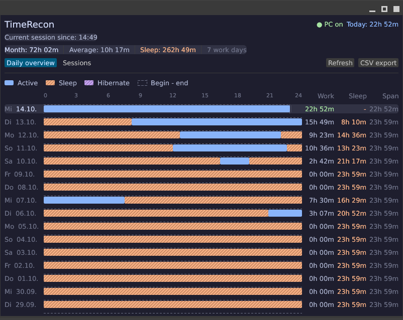

# TimeRecon

TimeRecon (`time-recon`) is a cross-platform (Linux, Windows, macOS) desktop utility that
reconstructs PC uptime and activity from system event logs and presents it as
daily activity bars and individual sessions using an Egui interface.



## Features

- Dual UI: Interactive Desktop GUI (Egui) and full-featured Terminal UI (Ratatui).
- Fast CLI utilities: `--status` for one-line shell statusbars and `--export` for headless CSV generation.
- Shows the last 120 calendar days as 24-hour aligned activity bars.
- Highlights sleep and hibernate periods inside each day and excludes them from
  the daily work time (see [doc/mockup-sleep.html](doc/mockup-sleep.html)).
- Lists the current day's boot-to-shutdown sessions.
- Calculates a monthly total and average over days with recorded activity.
- Exports the displayed time range as a semicolon-separated CSV file.
- Opens exported CSV files with the system default file manager (`xdg-open` on Linux,
  `explorer.exe` on Windows, `open` on macOS).
- Privacy-focused: No background daemon, no keylogging or window title snooping.

## CLI Usage

```bash
# Launch default UI (GUI if display available, otherwise TUI)
TimeRecon

# Force Terminal User Interface (Ratatui)
TimeRecon --tui

# Force Desktop GUI (Egui)
TimeRecon --gui

# Quick one-line status (ideal for Waybar, i3status, tmux)
TimeRecon --status
# Output: ● PC on | Today: 1h 14m (Active) | Sleep: 1h 16m

# Headless CSV export
TimeRecon --export ~/pc-activity.csv
```

## Architecture

The application has modular presentation and event aggregation layers:

| Component | Responsibility |
| --- | --- |
| `build.rs` | Embeds `assets/icons/app.ico` as the Windows executable icon on Windows. |
| `src/main.rs` | Application entry point and CLI mode dispatcher (GUI, TUI, status, export). |
| `src/egui_ui.rs` | Desktop GUI dashboard (Egui) with 24-hour timeline and session inspection. |
| `src/tui/` | Terminal User Interface (Ratatui) with Unicode timeline (`█` active, `░` sleep, `▓` hibernate). |
| `src/eventlog/mod.rs` | Aggregates raw events into sessions, splits at midnight, merges sleep segments, and generates CSV data. |
| `src/eventlog/windows.rs` | Queries Windows Event Log via native Win32 API (`windows` crate). |
| `src/eventlog/linux.rs` | Queries systemd journal via `journalctl` JSON streams for boots and sleep operations. |
| `src/eventlog/macos.rs` | Queries macOS `pmset -g log` and system boot history. |

## Event processing

### Windows

Queries the native Windows Event Log API through the Microsoft `windows` crate (`System` channel):

- Event ID `6005`: Session start (boot).
- Event ID `6006`: Session end (shutdown).
- Kernel-Power `42`: Sleep or hibernate entry.
- Kernel-Power `107`: Sleep resume.
- Kernel-Power `506` / `507`: Modern Standby entry/exit.
- Power-Troubleshooter `1`: Resume event with precise sleep and wake timestamps.

### Linux

Queries `systemd-journald` using JSON output:

- `journalctl --list-boots -o json`: Boot start (`first_entry`) and shutdown (`last_entry`). The current session has `index == 0`.
- Sleep & Resume Message IDs:
  - `6bbd95ee977941e497c48be27c254128`: Sleep operation started (`suspend` / `hibernate`).
  - `8811e6df2a8e40f58a94cea26f8ebf14`: System returned from sleep.

### macOS

Queries power logs and kernel boot timestamps:

- `sysctl -n kern.boottime`: Current system boot time.
- `pmset -g log`: Sleep and wake events.

### Domain Aggregation

Events are sorted chronologically before pairing. Start events begin a session; the subsequent shutdown closes it. Sessions spanning midnight are split across day boundaries. Power events create non-overlapping sleep periods that are subtracted from the gross session duration to produce active awake time.

## Development

The project requires a Rust toolchain with Cargo (Rust 2024 edition).

```bash
cargo check
cargo test
cargo run
```

Strict Clippy lints are enforced: `panic`, `unwrap_used`, and `expect_used` are denied in application code.

## License

Copyright (c) 2026 Alexander Drichel.

Licensed under the [MIT License](LICENSE).
