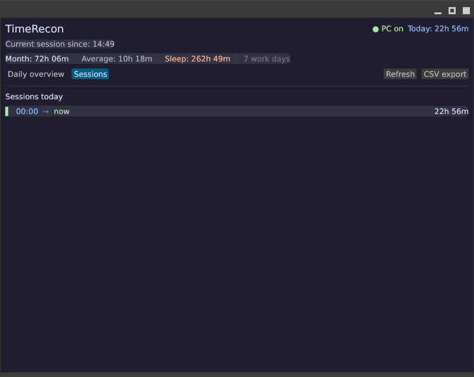

# TimeRecon User Guide

TimeRecon is a cross-platform (Linux, Windows, macOS) desktop utility that
reconstructs PC uptime and activity from operating system event logs. It gives
employees a personal overview of time spent with the PC; it does not monitor user
activity.

## Requirements

- Linux (systemd-journald), Windows 11, or macOS
- A Rust toolchain with Cargo when running from source

## Start the application

From the project root, run:

```text
# Default UI (GUI if display available, otherwise TUI)
cargo run

# Force Terminal UI (Ratatui)
cargo run -- --tui

# Force Desktop GUI (Egui)
cargo run -- --gui

# Print quick status line and exit (useful for Waybar / tmux)
cargo run -- --status

# Headless CSV export
cargo run -- --export my-export.csv
```

The application loads the last 120 calendar days when it starts. In the GUI, use the
refresh button; in the TUI, press `r` to reload the event log. In the TUI, use `Tab`
to switch views, `↑`/`↓` to navigate days, and `e` to export CSV.

## Use the overview

The header shows whether the PC currently has an open session and the total
uptime recorded for today. The monthly summary contains the accumulated
duration, the average across days with activity, and the number of such days.

The **Daily overview** tab lists each day in the selected 120-day period. Each
bar is placed on a 24-hour timeline. The dashed frame marks the earliest
session start and latest session end. Inside it, blue segments show time the
PC was awake, orange hatched segments show sleep (S3, suspend, or Modern Standby), and
purple hatched segments show hibernate. Hover a segment to see its time range.
The columns show the work time (awake time only), the sleep time, and the
begin-to-end span.


The **Sessions** tab lists the sessions that started today. An open session is
shown with its end time as `now`.



## Export data

Select **CSV Export** to write the currently configured 120-day range as a
semicolon-separated CSV file. The file name uses the format
`timerecon-export_YYYYMMDD_HHMMSS.csv` and is saved in the user's Documents
directory. If that directory is unavailable, the current directory is used.

The CSV contains these columns:

```text
Datum;Start;Ende;Dauer
```

After a successful export, click the status message in the application to open
the file in the operating system's default file manager (`xdg-open` on Linux,
Windows Explorer on Windows, `open` on macOS).

## Privacy and accuracy

TimeRecon reads only local system event logs (`systemd-journald` on Linux, Windows
System event log on Windows, and `pmset` on macOS). It does not collect or transmit
data, inspect window titles, record keyboard or mouse input, or measure screen-lock
or user-presence time.

Sleep and hibernate periods are subtracted from the daily work time.
Sessions that span midnight are split across the relevant calendar days.
